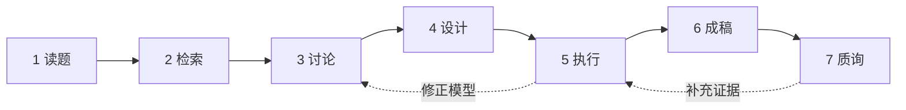

# math model skill

**先把题目读准，再把目标、模型、计算与论文连起来。**

面向中文数学建模的 AI 协作工具集。以自主设计的七步工作流为核心，配套模型与科学计算技能、论文绘图与写作工具、可直接使用的提示词，以及项目环境和论文模板。

**7 个原创技能 · 35 个现行技能 · 16 个历史入口 · 提示词与模板**

[快速开始](#快速开始) · [七步工作流](#七步工作流) · [提示词](#提示词) · [技能组合](#技能组合) · [模板与项目环境](#模板与项目环境)

## 从题意出发

数学建模首先要回答：研究对象是什么，题目真正要求确定什么，哪些条件必须保留，以及什么样的证据足以支持答案。

这套工作流把这些判断贯穿到求解与写作中：

- **读题有依据。** 区分题面事实、直接推论、建模假设与未解决的歧义，明确每问的输入、目标、约束和交付物。
- **模型由问题决定。** 根据机理、数据和任务选择表示与方法，说明转化的条件、用途和边界。
- **先跑通真实计算。** 从必要输入推进到题目要求的最终量，再针对关键不确定性补充证据；失败时重新判断根因与路线。
- **结论与证据对应。** 分清数值精度、模型适用性、可行性与最优性，保留可复现的计算入口。
- **论文围绕发现组织。** 把模型选择、关键推导与实际结果连成主线，修改意见融入论证。

用户主导问题理解与关键选择，AI 协助检索、推导、实现、核查和表达。

## 快速开始

### 1. 安装七步核心

需要 Python 3 和 Git。将下面的项目路径替换为你的工作目录：

```bash
git clone https://github.com/Leo91314/math-model-skill.git
cd math-model-skill
python3 scripts/install_skills.py --project "/path/to/your-project"
```

技能安装到目标项目的 `.agents/skills/`。默认只安装 7 个原创技能，已有同名目录会保留。安装器使用 Python 标准库；科学计算依赖单独配置。

### 2. 在目标项目中调用

在 Codex 中打开目标项目，提供题目和附件，然后发送：

```text
使用 $math-model-skill1-read，完整阅读题目和附件说明。
解释研究对象与各问任务，区分事实、推论、假设和歧义；
明确输入、目标、硬约束、单位、问间继承及交付物。
本次只读题，不提前选择模型。
```

有现成模型、结果或稿件时，直接进入相应步骤。技能发现与调用方式见 [OpenAI 官方文档](https://learn.chatgpt.com/docs/build-skills)。

## 七步工作流



| 步骤 | 主要解决什么 | 可交给后续的成果 |
|---|---|---|
| **[1 · 读题](skills/math-model-skill1-read/SKILL.md)** | 题目究竟要求什么？条件、量词与问间关系如何理解？ | 逐问任务、条件来源、歧义与交付要求 |
| **[2 · 检索](skills/math-model-skill2-research/SKILL.md)** | 哪些机理、模型与算法有依据，适用于本题？ | 候选方案、原始来源、成立条件与取舍 |
| **[3 · 讨论](skills/math-model-skill3-debate/SKILL.md)** | 用户的理解有哪些支持、反例与关键分歧？ | 当前模型、论文主张及所需证据 |
| **[4 · 设计](skills/math-model-skill4-design/SKILL.md)** | 怎样以合适的计算和比较判断模型与主张？ | 求解方案、评价指标、必要实验与判断标准 |
| **[5 · 执行](skills/math-model-skill5-execute/SKILL.md)** | 如何实际得到答案，并确认结果支持什么？ | 代码、真实结果、验证证据、图表与复现入口 |
| **[6 · 成稿](skills/math-model-skill6-refine/SKILL.md)** | 怎样让读者理解模型、发现与证据？ | 正文、摘要、结果解释及有主线的修订稿 |
| **[7 · 质询](skills/math-model-skill7-rebuttal/SKILL.md)** | 哪些问题会影响答案或核心结论的可信度？ | 有依据的质疑、试答与最小补证安排 |

七步是可独立调用、可以往返的入口。**第 5 步完成代码、实验与图表，第 6 步组织论文正文。** 已有材料直接复用，连续推进按用户授权的范围衔接。

详细职责见 [工作流指南](docs/workflow-guide.md)，旧调用名迁移见 [名称对照](docs/name-mapping.md)。

## 提示词

读题后的两个常见用法：

<details>
<summary><strong>已经有直觉，想共同确定模型</strong></summary>

```text
使用 $math-model-skill3-debate。
我的理解是：[你的判断、推导或方案]。
先准确表达我的意思，再给出支持依据、反例和替代解释。
聚焦影响路线的关键分歧，明确变量、目标、约束、假设与方法，
以及论文准备主张什么、需要什么证据。
本次先讨论，不启动完整实验。
```

</details>

<details>
<summary><strong>已经有计算结果，想写出连贯的论文</strong></summary>

```text
使用 $math-model-skill6-refine，依据已有真实结果撰写或修改[指定章节]。
先明确成立的中心发现，再组织困难、模型转化、求解、证据与结果解释。
核对关键推导、数字、单位和图表，贡献与题目绑定，保留适用范围。
把评价融入论证，修改记录另列，主文保持清楚的故事线。
```

</details>

更多场景见 [完整提示词](prompts/seven-stage-prompts.md)：方案检索、算法设计、实际求解、故障定位、论文制图、局部审查与模拟评阅。

## 技能组合

七步负责研究过程中的判断，辅助技能按实际任务补充。

| 资源 | 数量 | 主要用途 |
|---|---:|---|
| **math model skill 原创七步** | 7 | 读题、研究、模型讨论、设计、执行、写作与质询 |
| **BZD 数模社技能** | 12 | 题意核对、模型字典、整题思路与章节审查 |
| **科学计算技能** | 6 | SymPy、pymoo、SimPy、statsmodels、scikit-learn、NetworkX |
| **绘图、写作与工具配套** | 10 | 论文图、英文润色、LaTeX、PDF、Notebook、规划与技能管理 |

查看 [全部技能与来源](docs/skill-catalog.md)。第三方技能保留原作者名称。

选择安装范围：

| `--group` | 安装内容 | 数量 |
|---|---|---:|
| `core`（默认） | 原创七步 | 7 |
| `project` | 七步＋BZD＋科学计算 | 25 |
| `all` | 全部现行技能 | 35 |

```bash
python3 scripts/install_skills.py --project "/path/to/your-project" --group project
```

Word、表格与插件版 PDF 等能力的用途和获取方式见 [外部技能入口](docs/external-skills.md)。其中依赖客户端插件或运行库的部分按原产品提供。

## 模板与项目环境

### 从读题到成稿的模板

| 需要做什么 | 对应资料 |
|---|---|
| 将题意转成数学任务 | [问题定义工作表](templates/problem-definition.md) |
| 写好问题提出与分析 | [分析写作模板](templates/problem-analysis.md) |
| 说明假设的依据、作用与局限 | [模型假设](templates/model-assumptions.md) |
| 把论文主张与实际证据对应 | [证据卡](templates/evidence-card.md) |
| 保留输入、参数与复现入口 | [计算记录](templates/reproducibility.md) |
| 记录真实 AI 使用情况 | [AI 使用空表](templates/ai-usage-log.csv) |
| 开始中文 LaTeX 论文 | [空白论文模板](templates/latex-cumcm-2026/README.md) |

### 建立新的计算项目

从仓库根目录运行下面的命令。`my-modeling-project` 应是一个新建空目录：

```bash
mkdir ../my-modeling-project
cp -R templates/project/. ../my-modeling-project/
python3 scripts/install_skills.py --project ../my-modeling-project --group project
cd ../my-modeling-project
uv sync --locked
```

环境模板保留原项目的 **Python 3.12 依赖锁**与合成数据演示。恢复后用项目 `.venv/bin/python` 计算；数值与文档演示的运行方式见 [环境说明](templates/project/README.md)。

需要启动提醒与结束时的语法检查时，可使用 [hooks 示例](templates/hooks/README.md)，在 Codex 中审阅具体配置后启用。

## 来源与验证

本仓库整理了原项目技能和整理日的本机配套版本。旧版 16 个入口与早期提示词保存在 [历史归档](archives/README.md)，整理范围及本地改动见 [整理说明](docs/collection-notes.md)。

本次整理已实际检查技能安装、已有文件保留、名称与引用、语法及打包完整性，并编译了 LaTeX 空白模板，记录见 [发布检查](docs/publication-checks.json)。这些检查有明确范围；历史验证也按其原版本解读。

当前仓库为**公开资料库**，尚未指定统一开源许可证。原创技能、BZD 内容与其他第三方资源分别保留归属及许可，详见 [来源与授权](NOTICE.md)。模板中的 2026 赛事设置需按实际比赛重新核对，合成环境演示不能作为赛题结果。
