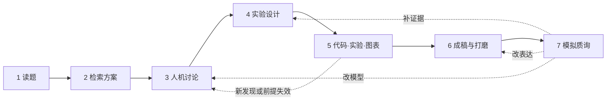

# math model skill

**把题目读懂，把模型做实，把论文写清。**

作者：[@Leo91314](https://github.com/Leo91314) · **2025 国奖｜2026 推国**

math model skill 是一套从题意理解走到计算、成稿与质询的数学建模人机协作工作流。你参与关键判断，AI 协助检索、推演和执行，让每一步都有明确目标、可用成果和下一步行动。

- **从问题出发**：把题目转成清楚的目标、变量和约束，再讨论适合的方法。
- **七步完整衔接**：读题、检索、讨论、设计、计算、成稿、质询，首页提供完整提示词与返工路径。
- **技能与模板一起准备**：原创七步搭配 BZD、科学计算、绘图写作与工具配套，共收录 **35 个现行技能**，附论文与项目模板；第三方资源保留原作者署名与许可说明。

> 由题目决定方法，由证据约束主张，再把成立的发现写清楚。

**读题 → 检索方案 → 人机讨论 → 实验设计 → 完成计算工作区 → 成稿与打磨 → 模拟质询**

[安装与准备](#安装与准备) · [流程总览](#流程总览) · [1 读题](#step-1) · [2 检索](#step-2) · [3 讨论](#step-3) · [4 设计](#step-4) · [5 执行](#step-5) · [6 成稿](#step-6) · [7 质询](#step-7) · [返工与衔接](#返工与衔接) · [配套资源](#配套资源)

## 安装与准备

需要 Python 3 和 Git。在终端执行，将项目路径替换为你实际放题目、代码和论文的目录：

```bash
git clone https://github.com/Leo91314/math-model-skill.git
cd math-model-skill
python3 scripts/install_skills.py --project "/path/to/your-project"
```

默认安装七步核心到目标项目的 `.agents/skills/`，已有同名目录会保留。然后在 Codex 中打开**目标项目**，提供原题和附件，从第 1 步开始。技能发现与调用方式见 [官方文档](https://learn.chatgpt.com/docs/build-skills)。

下文每一步都有可直接使用的提示词。方括号替换为实际内容；已经提供过的题目、讨论、代码和结果，直接引用当前会话或文件即可。

**先准备原题与已有材料。** 确认比赛、年份、题号和材料版本。原题齐全而数据附件未到时，可以先完成题意理解；有现成模型、结果或稿件时，从对应阶段进入。

**辅助技能按需使用。** 七步核心可以独立工作。下文涉及的 BZD、科学计算、绘图和写作技能，可通过文末的安装分组补充；Word、表格等客户端插件另见获取说明。安装技能与安装科学计算依赖是两件事。

## 流程总览

| 步骤 | 你提供或参与什么 | AI 主要完成什么 | 带到下一步的材料 |
|---|---|---|---|
| **1 · 读题** | 原题、图表、附件及补充说明 | 完整解释任务，辨清条件、限制与交付要求 | 逐问任务清单、歧义和结构线索 |
| **2 · 检索方案** | 已澄清的题意、数据条件及关注点 | 查历史文献、机理、模型与算法，比较适用性 | 有来源的候选方案及待讨论分歧 |
| **3 · 人机讨论** | 自己的理解、直觉、推导或疑问 | 准确复述，提出支持、反例与替代解释，共同修正 | 当前模型、方法思路、主张、贡献与所需证据 |
| **4 · 实验设计** | 已确定的模型和研究主张 | 选择求解算法，设计工况、指标、对照与判断标准 | 可执行的计算和验证方案 |
| **5 · 完成计算工作区** | 明确本次要完成的问题与范围 | 实现代码、真实求解、必要验证、图表和复现入口 | 能定位、复算并供写作使用的结果 |
| **6 · 成稿与打磨** | 实际结果、当前稿件和修改意见 | 写正文与摘要，打磨主线，检查技术与表达漏洞 | 有证据支撑、前后一致的论文 |
| **7 · 模拟质询** | 原题、稿件、代码与证据 | 找关键质疑，形成有依据的试答和最小补救方案 | 待修问题、处理路径与已关闭的问题 |

这里的衔接条件用于判断下一步工作。已有授权可以连续推进，无须为每一步重新确认，也无须凑齐七份报告。



<a id="step-1"></a>

## 1. 读题：把自然语言转成明确的任务

**使用技能：** [`math-model-skill1-read`](skills/math-model-skill1-read/SKILL.md)

你提供完整原题、图表和附件说明。AI 先通读整题，解释研究对象与背景机制，再逐问整理输入、未知量、目标、约束、单位、限定词和最终交付物，并保留原文位置。

这一步要区分五类信息：**明示事实、直接推论、待设假设、未解决歧义、交付要求**。例如，“所有位置达到阈值”与“平均值达到阈值”对应不同的数学任务；输出每分钟一行数据，也不自动意味着求解器必须采用一分钟步长。

读题时也可以观察变量联动、对称性、重复计算、可分离结构或替代表示。它们作为有依据的研究线索交给后续讨论，尚不当成已经成立的模型。

**交给下一步：** 一份能回答“每问究竟求什么、条件是什么、还缺什么”的任务清单。影响目标或约束的歧义需要澄清；不受缺失附件影响的理解可以继续完成。

```text
使用 $math-model-skill1-read，完整阅读[题目及附件]，沿用当前对话已有材料。

遇到 PDF 中的公式、图示或提取不清的内容，结合可用的 PDF 技能回看原页；
关键语句存在歧义时，可结合 $bzd-problem-translator 核对。

解释研究对象、背景机制和各问任务，列清已知条件、变量与单位、目标、
硬约束、限定词、跨问依赖和最终交付物，并标注来源位置。

区分题目明示事实、直接推论、待设假设和未解决歧义。
识别可能帮助降维、转化或构造解的结构线索，记录依据与待验证条件。

本次只读题，不求解、不提前定模型。
最终给我一份可以进入方案调研的逐问任务清单。
```

## 读题之后，问题提出与分析怎样形成

**第 1 步把任务读准确，第 2—3 步解释为什么采用某种建模转化，第 6 步再把已经站得住的分析组织成论文。**

论文中的“问题提出与分析”应让读者看清：需要解决什么、困难在哪里、题目提供了什么可利用的结构、为什么采用当前模型，以及各问如何联系。其论证来自实际研究中的判断。

可用 [问题定义工作表](templates/problem-definition.md) 整理任务，再按 [分析写作模板](templates/problem-analysis.md) 组织文字。两份模板服务于理解和表达，不要求逐格照搬进论文。

<a id="step-2"></a>

## 2. 检索方案：找到有来源、有适用条件的候选路线

**使用技能：** [`math-model-skill2-research`](skills/math-model-skill2-research/SKILL.md)

以第 1 步澄清的题意与数据条件为基础，AI 实际查读历史文献、原始论文和官方技术资料，寻找可行的模型表示、机理关系与求解算法。

候选方案需要说明：**解决哪个困难、需要什么输入、为什么适用、代价与风险是什么、怎样做最小验证**。查到一个算法名称，还不足以说明它能解决当前问题。只读到摘要的来源也应注明阅读范围。

解析方法、结构变换和非常规思路都可以进入候选。此时允许保留多个有竞争力的路线，交给你和 AI 共同讨论。

**交给下一步：** 可核查来源、候选方案比较，以及真正会影响路线的分歧。第 2 步交付的是讨论依据，最终方案在第 3 步结合你的判断形成。

```text
使用 $math-model-skill2-research，依据已澄清的题意和数据条件，
实际检索历史文献、原始论文及官方技术文档。

围绕本题的具体困难，寻找可行的模型表示、机理关系与求解算法。
需要补充整题思路时结合 $bzd-modeling-ideas；
需要理解某个具体模型时，再查询 $bzd-model-dictionary。

比较少量有竞争力的路线：解决什么、需要什么输入、成立条件、
实现成本、主要风险，以及下一项最小验证。

允许结构变换和非常规方法成为候选，记录来源与实际阅读范围。
交付方案比较和需要我们讨论的分歧。

本次不替我最终定案，不运行完整实验，不编造创新性或效果。
正式赛时按当届规则核对可使用的检索与交流范围。
```

<a id="step-3"></a>

## 3. 人机讨论：把你的理解打磨成站得住的模型

**使用技能：** [`math-model-skill3-debate`](skills/math-model-skill3-debate/SKILL.md)

这一步需要你表达自己的理解：可以是一段直觉、一个推导、一条路线，也可以是“我不确定这个假设是否必要”。

AI 先准确复述，再提出最有力的支持、反例和替代解释，集中讨论会改变模型选择的分歧。观点有依据就保留；发现反例后，判断可以保留哪些部分、是否需要收窄范围或调整路线。

共同形成下面这条关系：

**题目瓶颈 → 核心观察 → 模型或转化 → 论文主张与贡献 → 所需证据 → 适用边界**

特别要分清：等价变换保留了什么，近似忽略了什么，受限策略缩小了哪些选择，启发式依靠什么证据采用。贡献应对应本题的困难和实际发现。

**交给下一步：** 当前认可的变量、目标、约束、假设与方法思路，以及准备证明或检验的主张。尚未决定的关键选择继续讨论；已经认可的决定直接复用。

```text
使用 $math-model-skill3-debate。我的理解或方案是：[写出自己的想法]。

先准确复述我的意思，再提出最有力的支持、反例和替代解释。
不要迎合，也不要仅因为路线不常规就否定它；
优先讨论会改变模型选择的关键分歧。

需要精确推导时结合 $sympy，明确符号假设、定义域，并核对结果。

共同明确变量、目标、约束、关键假设和方法，形成：
题目瓶颈 → 核心观察 → 模型或转化 → 论文主张与贡献 → 所需证据 → 适用边界。

区分等价变换、近似模型、受限策略和启发式方法。
我尚未决定的关键选择保留讨论，已经认可的决定不反复确认。

本次先讨论，不启动完整实验，不预写性能提升。
```

<a id="step-4"></a>

## 4. 实验设计：把模型与主张变成可执行的求解和检验

**使用技能：** [`math-model-skill4-design`](skills/math-model-skill4-design/SKILL.md)

第 3 步明确研究模型和方法思路，第 4 步据此选择具体求解算法，设计输入工况、指标、对照、计算预算和判断标准。每项实验都应说明：它能帮助我们判断什么。

证据随任务而变化：

| 任务或主张 | 重点考虑的证据 |
|---|---|
| 数学转化与结构结论 | 推导前提、可核对特例、反例与适用范围 |
| 机理与数值计算 | 单位、初边值、适用的守恒关系、离散误差；有观测时进一步检验模型 |
| 优化与决策 | 原问题可行性、有效参照、同口径目标、最优性依据或已知边界 |
| 预测与统计推断 | 符合时间或分组结构的验证、残差、样本外表现及推断条件 |
| 参数敏感性 | 有依据的变化范围、响应程度、结论是否改变及失效情形 |

首个可信解可以直接来自解析关系或有依据的非常规表示。回归、K 折、SHAP 或“提升 5%”都不作为通用门槛；敏感性分析也可以得到模型不稳健的结论。

**交给下一步：** 能够实际执行的最小计算，以及扩展实验的输入、指标、比较口径、停止条件与图表用途。未运行的内容明确标记为设计。

```text
使用 $math-model-skill4-design。
我们已确定的模型和主张是：[内容，或引用已有讨论]。

根据变量类型、目标结构、约束、评价成本和精度需求，
选择合适的求解算法，按需调用相应科学计算技能。

把每项关键主张对应到最小必要证据：数学推导、可核对特例、
数值误差、完整可行性、样本外表现、优化质量或敏感性分析。

写清实验输入、指标与单位、参照方法、比较口径、判断标准，
以及图表要回答的问题。参数扰动范围要有依据。

先设计最小真实计算，再安排能够改变判断的扩展实验。
不机械要求回归、K 折、SHAP 或固定提升幅度。
本次只设计，未执行内容明确标记。
```

<a id="step-5"></a>

## 5. 执行：完成代码、真实实验、验证和图表

**使用技能：** [`math-model-skill5-execute`](skills/math-model-skill5-execute/SKILL.md)

你明确本次要完成的小问或任务范围。AI 按已有方案，先跑通**真实输入 → 模型 → 求解 → 题目最终指标 → 关键约束检查**，再完成授权范围内的工况与验证。题面给定的参数可以构成真实输入；合成特例则保持测试身份。

遇到失败时，先区分数据语义、模型前提、数值算法、代码实现或环境问题。计算中发现有价值的新结构，可以立即用小推导或实例判断；如果它改变了核心模型选择，就回到第 3 步。

**本步交付：**

- 能运行的代码与必要依赖说明。
- 逐问实际结果、单位与计算口径。
- 支撑当前结论的验证证据及限制。
- 来自真实结果的图表、说明和数据出处。
- 输入、参数、命令与适用的随机种子，足以复算关键数字。

**交给下一步：** 这些计算成果与解释材料。第 5 步不写论文正文；结果缺失时如实指出，不能把计划计算当成已完成实验。

```text
使用 $math-model-skill5-execute，
按已经确定的模型和实验设计完成[问题或任务范围]。

复用现有附件、代码和依赖，使用项目 .venv/bin/python。
先跑通最小真实输入到最终指标及关键约束检查的完整链路，
再完成本次范围。

按模型需要调用对应科学计算技能。失败时先判断根因和路线，
不无依据增加模块、放宽约束或替换参数。

完成必要的比较与验证，保留实际输入、参数、运行命令、
适用的随机种子和输出，区分实际结果、理论推导和未做检查。

需要论文级图形时可使用 $nature-figure，后端选 Python，
版面服务中文数模论文。图表来源于真实结果，并查看生成后的显示效果。

交付代码、逐问结果、验证证据、图表及说明、复现入口。
本步不写论文正文。
```

**第 4—5 步如何搭配计算技能：**

| 场景 | 可追加到提示词中的要求 |
|---|---|
| 精确推导、方程、符号化简 | 结合 `$sympy`，明确成立条件，并通过代回或特例核对。 |
| 多目标、复杂约束优化 | 结合 `$pymoo`，明确评价预算、约束处理与方案选择依据，回原问题复核可行性。 |
| 排队、资源竞争、离散事件 | 结合 `$simpy`，核对事件机制、时间单位与随机输入，设计必要的独立重复。 |
| 统计推断、回归、时间序列 | 结合 `$statsmodels`，检查观测依赖、残差与推断条件。 |
| 预测、分类、聚类 | 结合 `$scikit-learn`，按样本结构设计验证，防止预处理造成数据泄漏。 |
| 路径、网络、图结构 | 结合 `$networkx`，先明确节点、边、方向与权重的实际含义。 |

普通数组计算、常微分方程和常规优化可以直接使用 NumPy、SciPy。工具的选择服从模型与任务。

<a id="step-6"></a>

## 6. 成稿与打磨：让中心发现贯穿全文

**使用技能：** [`math-model-skill6-refine`](skills/math-model-skill6-refine/SKILL.md)

以实际结果和当前稿件为依据，先明确文章真正能够主张什么，再按**问题困难 → 核心观察 → 模型转化 → 求解方法 → 验证证据 → 结果解释**组织正文与摘要。

打磨同时包括表达与技术：检查假设有没有用途、关键推导是否完整、理论前提是否满足、数字与图表是否一致，以及结论有没有超过证据。合理修改意见进入文章自身的论证结构，修改记录另列。

**交给下一步：** 主线清楚、关键结果与证据一致的稿件。文字问题直接修订；需要补算的实质缺口回到第 4—5 步；影响模型选择的分歧回到第 3 步。

```text
使用 $math-model-skill6-refine，依据[已验证结果与当前稿件]，
撰写或修改[章节/全文]，使用中文。

先明确真正成立的中心发现，再组织：
问题困难 → 核心观察 → 模型转化 → 求解方法 → 验证证据 → 结果解释。

核对假设用途、关键推导、单位、约束、理论前提和数值一致性。
发现实质漏洞时提出最小补证，不用润色掩盖问题。

按实际缺口调用对应 BZD 审查技能，已有材料直接复用，
审查发现用于实际修订。

压缩通用算法介绍和重复内容，让贡献与题目强绑定，
准确保留适用边界。结果改变时同步检查摘要、图表与结论。

保持正文主线，修改记录单独列出，不把文章写成逐项回答评委。
未验证的结果不得写成既成事实。
```

**写作时按章节补充审查：**

| 当前材料或问题 | 可用辅助技能 |
|---|---|
| 问题分析能否解释模型选择 | `bzd-problem-analysis-checker` |
| 假设是否必要、合理并真正参与模型 | `bzd-model-assumption-checker` |
| 符号、含义、单位与公式是否一致 | `bzd-symbol-notation-checker` |
| 摘要是否独立讲清问题、方法、结果与亮点 | `bzd-abstract-checker` |
| 引用、附录、程序与支撑材料是否对应 | `bzd-reference-appendix-checker` |

需要正式文件时，在提示词末尾追加对应格式：

```text
LaTeX：结合 $latex-writing 和可用的 PDF 技能，采用当届比赛模板，
生成源文件与 PDF，实际编译并逐页检查最终文件。
```

```text
Word：结合可用的 documents 技能，保留指定模板，
生成可编辑 Word，并渲染检查分页、公式和图表。
```

<a id="step-7"></a>

## 7. 模拟 rebuttal：找出真正影响可信度的质疑

**使用技能：** [`math-model-skill7-rebuttal`](skills/math-model-skill7-rebuttal/SKILL.md)

这是队内模拟评阅与答辩。AI 对照原题、稿件、代码和实际证据，优先检查会改变答案或动摇核心主张的问题，例如题意遗漏、约束被替换、假设失真、推导缺口、比较口径不一致、结果无法复现，以及结论超过证据。

每项质疑应包含：**具体位置 → 依据 → 后果 → 当前能够作出的回答 → 缺失证据 → 最小补救**。已经被证据充分回答的问题关闭；仍然成立的贡献继续保留。

**交付与后续：** 一份有依据的质询记录和修复安排。该改模型、补实验还是改表达，要能据此作出判断。最终稿还需按当届要求核对格式、匿名、引用、AI 披露与支撑材料。

```text
使用 $math-model-skill7-rebuttal，
对照原题、当前稿件和实际证据，模拟内部评阅与答辩。

结合 $bzd-model-solution-checker，优先寻找会改变答案或削弱核心主张的问题：
题意遗漏、约束偷换、假设失真、推导缺口、求解与模型不一致、
不公平比较、结果无法复现、结论超过证据。

每项重要质疑给出具体位置、依据、影响、目前能够作出的回答，
以及最小补救措施。已经被证据充分回答的问题关闭。

区分需要改模型、补实验和改表达的问题。
不把流行算法或固定检验当成评分要求，不编造评分权重或预测奖级。

本次只预审，不修改模型、不运行长计算、不对外发送。
答辩记录与正文分开，保护仍然成立的中心发现。
```

## 返工与衔接

研究可以往返。根据问题出在哪里，回到能解决它的步骤：

| 当前发现 | 下一步 |
|---|---|
| 题意、量词、单位或交付要求读错了 | 回第 1 步，修正受影响的任务定义 |
| 已有候选缺少可靠来源或适用条件 | 回第 2 步，补针对性的检索 |
| 假设、模型结构或论文主张站不住 | 回第 3 步，共同修正方案 |
| 证据不足、比较不公平或指标不能支持主张 | 回第 4 步调整设计，再由第 5 步执行 |
| 实现错误、缺结果或图表需要重做 | 回第 5 步，处理受影响的计算与输出 |
| 已有证据充分，但推导、表述或图表说明不清楚 | 回第 6 步修订 |
| 相关问题已修复，需要判断能否关闭质疑 | 第 7 步定向复审 |

连续授权设计与执行时，可以这样说：

```text
使用 $math-model-skill4-design 和 $math-model-skill5-execute，
沿用已认可的模型，先设计必要实验，再实际完成代码、计算、验证和图表。
```

按质询结果修订时，可以这样说：

```text
按刚才的审查结论，先用 $math-model-skill5-execute 补必要计算，
再用 $math-model-skill6-refine 修订受影响的正文、摘要和图表。
如果需要改变尚未定案的核心模型选择，回第 3 步集中讨论。
复用已有成果，不重跑无关工作；正文按自己的论证结构组织。
```

## 配套资源

### 选择安装范围

仓库共有 **35 个现行技能**：原创七步 7 个、BZD 数模社 12 个、科学计算 6 个、绘图写作与工具配套 10 个。第三方保留原作者名称，完整列表见 [技能目录](docs/skill-catalog.md)。

| 安装组 | 内容 | 命令参数 |
|---|---|---|
| 七步核心，7 个 | 完成上述研究流程的主入口 | `--group core`，默认 |
| 项目组合，25 个 | 七步＋BZD＋科学计算 | `--group project` |
| 全部现行技能，35 个 | 再加入绘图、写作与工具配套 | `--group all` |

例如安装全部现行技能：

```bash
python3 scripts/install_skills.py --project "/path/to/your-project" --group all
```

Word、表格、插件版 PDF 等外部能力见 [外部技能入口](docs/external-skills.md)。技能安装不代表客户端插件或其运行库已经就绪。

### 工作模板

| 阶段 | 可复用材料 |
|---|---|
| 读题与问题分析 | [问题定义工作表](templates/problem-definition.md)、[分析写作模板](templates/problem-analysis.md) |
| 讨论模型与主张 | [模型假设](templates/model-assumptions.md)、[证据卡](templates/evidence-card.md) |
| 计算与复现 | [计算记录](templates/reproducibility.md) |
| 写作与披露 | [中文 LaTeX 空白模板](templates/latex-cumcm-2026/README.md)、[AI 使用记录空表](templates/ai-usage-log.csv) |
| 专项调用 | [完整提示词与辅助技能配对](prompts/seven-stage-prompts.md) |

### 新建计算工作区

从本仓库根目录开始，选择一个尚未存在的项目目录。环境恢复需要已安装 `uv`：

```bash
mkdir ../my-modeling-project
cp -R templates/project/. ../my-modeling-project/
python3 scripts/install_skills.py --project ../my-modeling-project --group project
cd ../my-modeling-project
uv sync --locked
```

环境模板保留 Python 3.12 依赖锁。恢复后使用项目 `.venv/bin/python`；原件、代码与成果可按下列结构组织，已有项目结构也可以继续使用：

```text
your-project/
├── .agents/skills/   已安装技能
├── problem/          原题与附件说明
├── data/raw/         原始数据
├── data/processed/   有处理依据的衍生数据
├── src/              求解代码
├── outputs/          实际结果、图表与必要记录
└── paper/            论文源文件与导出稿
```

环境演示及文档导出方式见 [环境说明](templates/project/README.md)。需要启动提醒与结束时的语法检查时，按 [hooks 示例](templates/hooks/README.md) 配置并审阅启用。

## 规则、来源与验证范围

正式使用时，按比赛、年份、组别与赛区查阅当前原题、参赛要求、格式和 AI 使用规定。仓库保留的 [规则与评阅依据](skills/math-model-skill1-read/references/rules-and-review.md) 是有日期的历史快照；公开评阅原则、历史题目讲评与我们自己的方法建议分别对待，未公开的细则保持未知。

AI 使用记录应反映真实用途、采纳与人工核验情况，AI 自检不能记成人工审核。是否开展进一步计算或对外提交，按实际用户授权与适用要求处理。

本次资料整理的安装、名称与引用、语法、打包和 LaTeX 编译检查见 [发布检查](docs/publication-checks.json)。历史技能测试按其 [原记录](docs/historical-validation.md) 中的版本与范围解读；合成环境演示不能作为赛题结果。

当前为公开资料库，未指定统一开源许可证，各资源归属与许可见 [来源与授权](NOTICE.md)。旧版 16 个入口保存在 [历史归档](archives/README.md)；调用名迁移见 [名称对照](docs/name-mapping.md)，整理过程见 [整理说明](docs/collection-notes.md)。

---

如果这套工作流对你有帮助，欢迎 **Star**，也欢迎分享使用中的问题与改进建议。把这份 README 发给队友，可以从同一套流程开始讨论、计算与写作。
